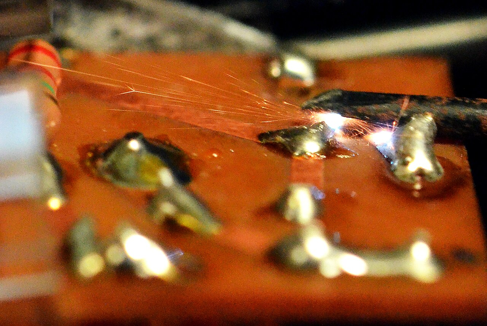
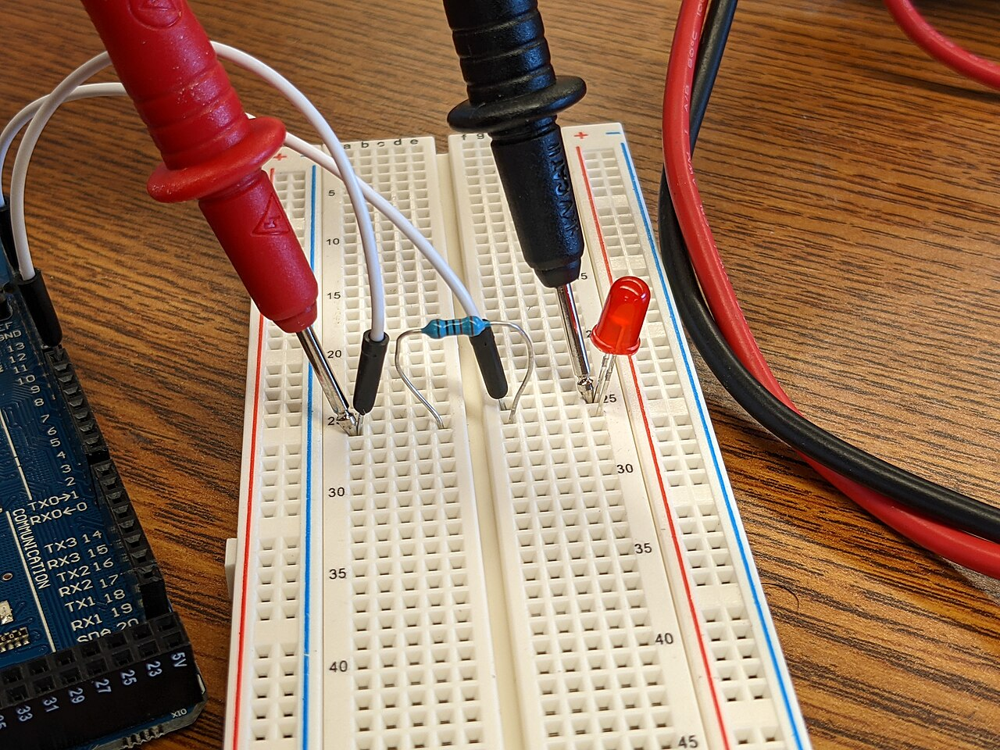
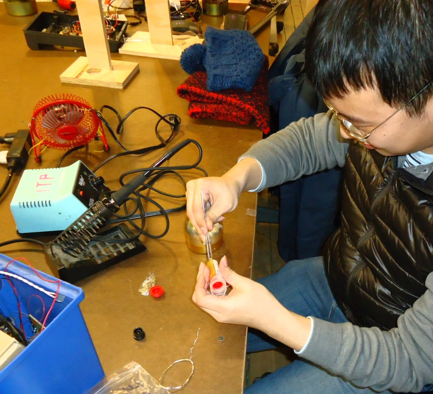
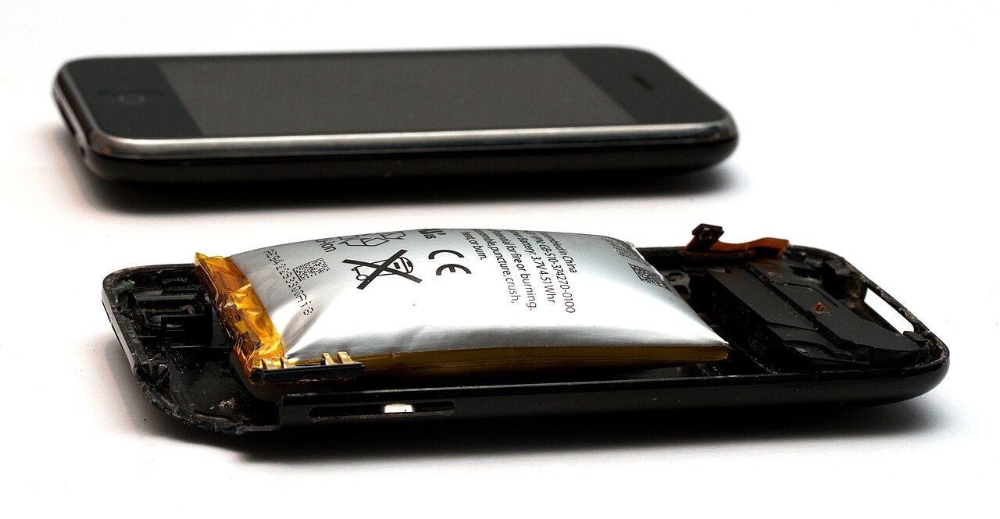
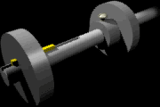
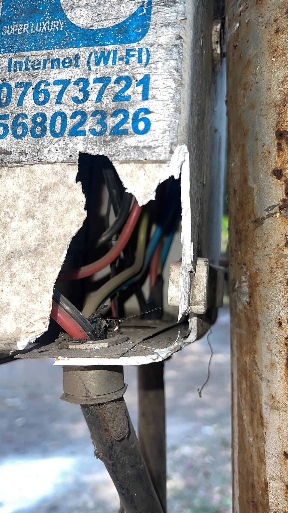

# 危险操作视觉素材索引

这些图片用于知识库检索、视觉提示词设计和人工验收示例，不构成足够的模型训练集。不得因图片中未出现某种危险，就推断实际操作安全。

## V02：故意短路

- 文件：`images/v02-intentional-short-circuit.jpg`
- 可见证据：金属螺丝刀跨接电路板端子，并出现明显火花。
- 风险：短路、电弧、金属飞溅、器件或电源损坏。
- 禁止推断：不能从单张照片确定电压、电流或保护是否动作。
- 作者：櫻井貫大（Sakurai Takahiro）。
- 许可：CC BY-SA 4.0。
- 来源：https://commons.wikimedia.org/wiki/File:短絡(Short_circuit).jpg

## V03：万用表探测

- 文件：`images/v03-multimeter-breadboard.jpg`
- 可见证据：两支表笔接触插入面包板的导线。
- 用途：正常测量姿态示例，可与表笔跨接相邻电源端、插错电流插孔等危险样本对比。
- 禁止推断：看不到仪表档位、插孔和供电状态时，不能判断操作正确。
- 作者：Zeroping。
- 许可：CC BY 4.0。
- 来源：https://commons.wikimedia.org/wiki/File:Multimeter_probes_on_breadboard.jpg

## V04：焊接热源

- 文件：`images/v04-soldering-work.jpg`
- 可见证据：人员使用烙铁进行电子焊接。
- 检查点：烙铁位置、热端朝向、支架、烟雾抽排、眼部防护、易燃物和工作区饮食。
- 禁止推断：普通照片不能可靠判断烙铁温度和空气污染物浓度。
- 作者：Tomwsulcer。
- 许可：CC0 1.0。
- 来源：https://commons.wikimedia.org/wiki/File:NYU_student_soldering_electronic_components.jpg

## V05：鼓包锂电池

- 文件：`images/v05-swollen-lipo.jpg`
- 可见证据：软包电池明显膨胀并使设备外壳变形。
- 风险：内部故障、进一步发热、起火和有害烟气。
- 动作：停止使用和充放电，不挤压、不刺破，按当地危险废物和消防要求处理。
- 作者：Mpt-matthew。
- 许可：GFDL 1.2 或更高版本；原页面还列有其他可选许可，使用时以来源页为准。
- 来源：https://commons.wikimedia.org/wiki/File:Expanded_lithium-ion_polymer_battery_from_an_Apple_iPhone_3GS.jpg

## V07：旋转轴卷入点

- 文件：`images/v07-rotating-shaft.gif`
- 可见证据：旋转轴、皮带轮、突出键和紧定螺钉形成卷入/勾挂危险。
- 检查点：防护罩、头发衣物、线缆、手部距离和机械急停。
- 作者：美国职业安全与健康管理局（OSHA）。
- 许可：美国联邦政府作品，Public Domain（美国）。
- 来源：https://commons.wikimedia.org/wiki/File:Shaft_animation.gif

## V08：激光眼部防护

- 文件：`images/v08-laser-goggles.jpg`
- 可见证据：实验人员佩戴激光安全护目镜。
- 用途：PPE 正例；视觉系统仍应检查光束路径、遮挡和联锁。
- 禁止推断：仅凭外观不能确认护目镜是否匹配激光波长与光密度。
- 作者：Thctamm。
- 许可：CC BY-SA 3.0。
- 来源：https://commons.wikimedia.org/wiki/File:Young_scientist_and_their_tutor_wearing_laser_safety_goggles.JPG

## V09：裸露线路

- 文件：`images/v09-exposed-wiring.jpg`
- 可见证据：外壳损坏、线路裸露并可被直接接触。
- 风险：电击、短路和环境侵入；未知电压时按更高风险处理。
- 禁止推断：不能从外观确定线路是通信、电源还是已断电线路。
- 作者：ShriniwasGajare。
- 许可：CC BY-SA 4.0。
- 来源：https://commons.wikimedia.org/wiki/File:Exposed_wiring_within_a_damaged_electrical_enclosure,_likely_for_internet_or_power_distribution.jpg
