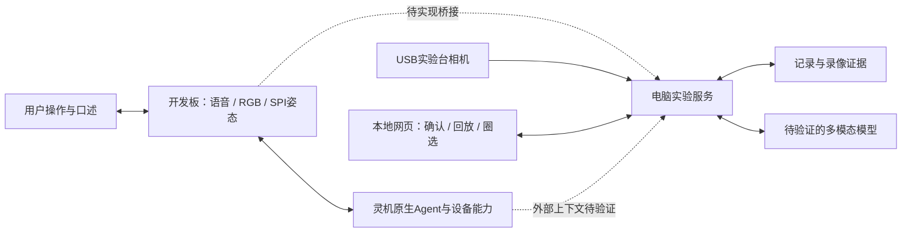

# AI 实验台助教：产品范围

2026-10-31。这里描述方向与待实现目标，不是功能完成声明。

## 需求与验证

实验排错需要知道“刚才改过哪里、测到什么、接下来怎样区分原因”。动手时难以完整记录，当前画面也可能丢失问题之前的变化。我们尝试把口述记录与历史画面用于排错。

这仍是价值假设。邀请真实学习者完成已有电路实验，观察是否愿意口述确认、是否主动回看、建议能否带来有效复测，以及记录是否反而打断实验。对同一问题比较“当前画面”和“加入历史证据”的建议，记录引用是否正确、验证是否有效及无依据结论。小样本不宣传准确率或学习效果。

## 首版范围

### 当前源码实现

网页默认入口已经改为实验记录工作区，支持手动测量的核对确认、浏览器保存、刷新回读、实验隔离、关联复测、撤销恢复、人工复盘和 Markdown 导出。没有预置实验或虚构测量。旧面试前端在 `a/legacy/interview/`，旧服务以 `npm run start:legacy` 单独回归。

这只是完整产品的第一步：语音最终转写、电脑录像和模型没有接入网页，不宣称口述记录、证据分析或整机闭环已完成。当前格式见 [本地记录说明](interfaces/a-local-records.md)，不作为跨模块契约定稿。

| 优先级 | 内容 | 完成依据 |
|---|---|---|
| P0 | 会话与测量确认 | 真实最终转写→补充信息→用户确认→持久化回读 |
| P0 | 操作留痕与回溯 | 先短片段，再600秒滚动、锁片、回放与时间定位 |
| P0 | 圈选与证据排错 | 确认对象，引用事件/时间，给一项优先验证 |
| P0 | 复测与复盘 | 前后测量可追溯，事实与推断分开 |
| P0 | 赛题设备基础 | 原生语音、RGB、SPI姿态、至少三种使用状态、实际平台调用，分别验收 |
| P1 | 一种防护用品辅助识别 | 新模型单独测试，包含遮挡与未知，不输出“现场安全” |
| P2 | 手指定位、舵机与IMU | 本轮不作为前置依赖 |

首个实验选团队已有电路图、仪表与测量点的低压小电路。参数、参考值、误差依据真实器材，不预编正确答案。先用网页圈选确认对象。

## 两条使用流程

记录：开始实验 → 口述测量 → 补充位置/单位/条件 → 确认 → 保存 → 复盘。

排错：提问并确认圈选对象 → 查看真实历史 → 区分观察和原因假设 → 一项复测 → 更新原实验。

SPI看人，USB看台面。型号、对焦、反光与遮挡必须实拍。现有肩线模型不能识别护目镜、元件或心理状态。

## 跨模块契约提案

以下待A/B/D联调固定，不是现有已批准接口：

- 统一experiment_id、event_id、来源、发生时间、接收时间、确认状态。
- 测量包括位置、物理量、数值、单位、条件、语音引用，区分口述、仪表采集和AI假设。
- 最终转写仍需确认；重试去重，结束实验后不串数据。
- 接收时间不冒充采集时间，设备重启重新建立映射。
- 录像显示实际范围、暂停与缺片，分析期间锁片，片段可独立解码。
- 无历史、遮挡、模型失败时明确报错或证据不足，不用固定答案冒充分析。
- 同一电脑一个串口读取者、一个后台录像源，预览复用录像源。

先分别测试转写导出、结果播报、下一轮引用电脑独有事实。若仅能播报，采用原生语音＋电脑分析＋结果播报的混合路线，网页承接证据追问；不宣称统一记忆。见 [平台手册](platform.md)。
